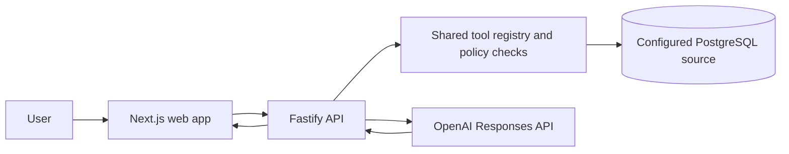

# DPsoft Workspace

DPsoft Workspace is a TypeScript monorepo for a tenant-aware business application and API. Its current reporting path connects an organization to PostgreSQL, exposes a controlled monthly-revenue tool, and can call that tool through OpenAI's Responses API. The repository also includes a local connector CLI and an MCP tool adapter.

This is an active software project, not a claim of production readiness or security certification. The implemented scope and known gaps are described below and in the linked documentation.

## Current capabilities

- Register and authenticate users, create organizations, and apply tenant-scoped permissions.
- Configure and test a PostgreSQL connector, inspect its schema, and select data for the reporting tool.
- Run the `monthly_revenue` tool through the shared policy registry and return the observed result with its source.
- Create agents and request a monthly revenue report using the OpenAI Responses API.
- Review application audit events and use the local connector CLI for its supported pairing and file-action workflow.
- Build an MCP adapter that registers tools with the shared registry. Public MCP transport is not enabled while OAuth resource-server enforcement is pending.

The current finance reporting flow is intentionally narrow: PostgreSQL and one monthly-revenue tool. Connector catalogs, MFA, enterprise SSO, general-purpose workflows, and public MCP access are not complete features. See [the security model](docs/security.md) for additional implementation gaps.

## Architecture



The API is a modular monolith. The MCP package adapts registered tools to the protocol SDK, but it is not currently exposed as a public transport. The local connector is a separate process for supported actions in a customer-controlled environment.

## Technology

- TypeScript and Node.js (Node.js 22 or newer; npm 11.8 is declared by the root package)
- Next.js web application and Fastify API
- PostgreSQL with Prisma; Redis is included in the local Compose stack
- OpenAI Responses API for the current agent reporting path
- Docker Compose for local PostgreSQL and Redis

## Run locally

### Prerequisites

- Node.js 22 or newer and npm 11 or newer
- Docker with the Compose plugin
- An OpenAI API key to use the agent reporting flow

### Setup

```bash
git clone https://github.com/denilsonpuro/dpsoft-workspace.git
cd dpsoft-workspace
cp .env.example .env
npm install
docker compose up -d postgres redis
npm run db:generate -w @dpsoft/database
npm run db:migrate -w @dpsoft/database
```

Edit `.env` and set `OPENAI_API_KEY` before using the agent reporting flow. Values in `.env.example` are for local development only; replace the example session and encryption secrets with locally generated values. Do not commit `.env` or use the Compose credentials in a deployed environment.

### Optional demo data

Only run this seed against a disposable local database configured in `DATABASE_URL`:

```bash
npm run db:seed-demo -w @dpsoft/database
```

The seed creates `dpsoft_demo.invoices` in the database named by `DATABASE_URL`, truncates that table before inserting its sample rows, and creates a demo reader role. It does not create a separate source database. Do not run it against a shared, staging, or production database.

### Start the API and web app

Run these in separate terminals from the repository root:

```bash
npm run dev -w @dpsoft/api
```

```bash
npm run dev -w @dpsoft/web
```

The API defaults to `http://localhost:4000` and the web app to `http://localhost:3000`. The health endpoint is `http://localhost:4000/health`. To get a report, configure a PostgreSQL connector and select its supported reporting data in the application; the API key and a reachable source database are required for a live agent response.

## Checks

Run the repository checks from the root:

```bash
npm run check
```

This runs lint, type checking, tests, and builds for workspaces that define those scripts. Individual commands are also available as `npm run lint`, `npm run typecheck`, `npm run test`, and `npm run build`.

## Documentation

- [Development setup and current scope](docs/development.md)
- [Architecture](docs/architecture.md)
- [Connector behavior](docs/connectors.md)
- [MCP gateway status](docs/mcp.md)
- [Security model and remaining work](docs/security.md)
- [Deployment validation and its limits](docs/deployment.md)

## License

This repository does not currently include a `LICENSE` file. No reuse permissions are stated here.
