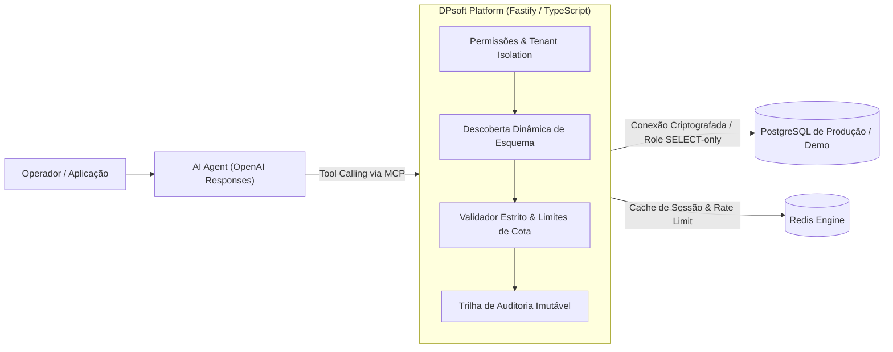

# DPsoft AI Integration Platform

[](https://www.typescriptlang.org/)
[](https://modelcontextprotocol.io/)
[](https://www.postgresql.org/)
[]()

> Enterprise integration infrastructure that gives AI controlled, auditable, and secure access to existing production databases and business software.

---

## 📌 The Problem & Architectural Vision

Connecting Large Language Models (LLMs) directly to production databases introduces catastrophic security and compliance risks: raw connection strings exposed to model providers, unauthorized table drops, schema leaks, and halluncinated queries executing without human oversight.

The **DPsoft AI Integration Platform** implements a strict **Model Context Protocol (MCP)** governance layer between autonomous AI agents and enterprise databases.



---

## 🛡️ Security Guarantees & Core Features

- **Zero Credential Exposure:** Database connection credentials never leave the secure server perimeter. AI agents receive only strongly-typed, auto-generated tool interfaces.
- **Dynamic Schema Discovery:** Introspects tables, types, and relations in real-time, enforcing explicit column-level whitelist authorization (e.g., explicit revenue or metric columns).
- **Strict Read-Only Enforcement:** Enforces PostgreSQL `SELECT`-only roles (`dpsoft_demo_reader`) to make state modification structurally impossible.
- **Immutable Audit Logging:** Every agent query, tool invocation, token count, and data response is stored in structured audit tables for compliance and observability.
- **Multi-Tenancy & Resource Metering:** Tenant-level rate limiting, quota enforcement, and plan-based usage boundaries.

---

## 🛠️ Stack & Infrastructure

- **Language & Runtime:** TypeScript (Strict Mode), Node.js (v22 LTS)
- **Frameworks:** Next.js (Admin / Onboarding UI), Express / Fastify (API Core)
- **Database Layer:** PostgreSQL, Prisma ORM, Redis (Rate limiting & sessions)
- **AI Tooling:** OpenAI Responses API, Anthropic Claude Tool Calling, Model Context Protocol (MCP)
- **DevOps:** Docker, Docker Compose, Multi-stage builds

---

## 🚀 Local Development & Quickstart

### Prerequisites
- Node.js >= 22.x
- Docker & Docker Compose

### 1. Clone & Setup Environment
```bash
git clone https://github.com/denilsonpuro/dpsoft-workspace.git
cd dpsoft-workspace
cp .env.example .env
```

### 2. Start Supporting Infrastructure
```bash
docker compose up -d postgres redis
```

### 3. Install Dependencies & Migrate
```bash
npm install
npm run db:generate -w @dpsoft/database
npm run db:migrate -w @dpsoft/database
```

### 4. Seed Local Demo Dataset
```bash
# Seeds an isolated, read-only demo source for the finance agent:
npm run db:seed-demo -w @dpsoft/database
```

### 5. Launch Services
```bash
# In terminal 1 (API Server):
export OPENAI_API_KEY="your-api-key"
npm run dev -w @dpsoft/api

# In terminal 2 (Admin UI):
npm run dev -w @dpsoft/web
```

Open `http://localhost:3000` to interact with the onboarding workflow and the AI Finance Agent.

---

## 📄 License & Audit

Proprietary enterprise infrastructure. See [docs/development.md](docs/development.md) for architecture deep-dives and compliance specs.
